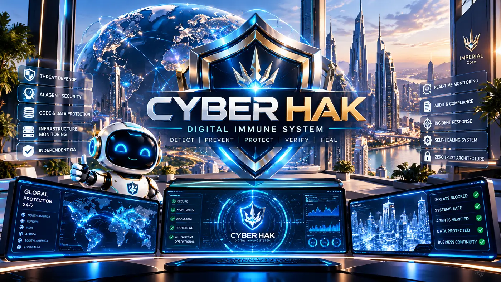

# CYBER HAK

  

**Project creator & founding architect:** **Alexander Nikolaevich Romaskevich** (Alexander Nikolaevich Romaskevich · RomaskevicH). [Authorship & contribution provenance](AUTHORS.md).

  

Defensive security and digital immune-system architecture for IMPERIAL Core.

[Enterprise Security Checkpoint — 1 November 2026](docs/ENTERPRISE_SECURITY_CHECKPOINT_20261101.md) — confirmed regression evidence, limitations and next controlled security gates.

## IMPERIAL EYE — verified-source world atlas + owner passkey pilot

[Source, browser UI, privacy design and local run instructions](security/imperial_eye/README.md) · [original interactive atlas](security/imperial_eye/web/index.html) · [publisher registry](security/imperial_eye/data/sources.json) · [security CI](.github/workflows/imperial-eye.yml).

**Implemented:** an original zero-cost, locally servable world-source navigator; two official public agency portals, plus **one genuinely retrieved Fintraffic response containing 816 validated station metadata records**, with **12 representative station cards** and official published still-image links. Metadata is a dated, non-live sample; stale image links are withheld after 24 hours. Source validation, anti-tracking policies, and real Chromium visual tests passed. The owner login UI uses a **WebAuthn passkey challenge contract** and does not collect images or biometric templates. Supported devices may use Face ID locally, but **actual server-side passkey verification and enrollment are not deployed**.

**Owner Passkey progress:** a separate [real ES256 WebAuthn signature-verification engine](security/imperial_eye/owner_webauthn.py) now enforces origin/RP/challenge/UV/counter checks with synthetic test credentials. [48/48 security tests PASS on Python 3.11 and 3.12](https://github.com/oromaskevic23-cmd/CYBER-HAK-Public/actions/runs/41597973689). Actual Owner passkey enrollment and server endpoints remain NOT DEPLOYED.

**No misleading claims:** the site does not provide live video streams, every camera in the world, private-camera access, biometric identification of other people, live agent deployment or a cloud owner-auth backend. CODEOWNERS routes critical files to the Founder but requires an enforced branch rule to have blocking effect. External projects were researched, not copied.

## IMPERIAL Owner Authority Guard — signed root protection (3 November 2026)

[Source and threat model](security/owner_authority_guard/README.md) · [Ed25519 verifier](security/owner_authority_guard/guard.py) · [external key trust check](security/owner_authority_guard/verify_cli.py) · [GitHub Actions proof](https://github.com/oromaskevic23-cmd/CYBER-HAK-Public/actions/runs/41590533895).

**Verified:** 22/22 tests passed on Python 3.11 and Python 3.12 using real Ed25519 verification and ephemeral laboratory keys. The guard rejects agent impersonation of Founder, Owner and CEO, forbids technical transfer of root authority, checks external public-key trust, replay, expiry, canonical identity and signed scopes.

**Not activated:** the real Owner private signing key has **not** been enrolled; GitHub Ruleset enforcement, external independent protected policy service and production HANTER/Guardian/Approval/NCA call-site integration remain unverified. CODEOWNERS does not independently enforce merge restrictions. The guard cannot prevent edits by a compromised repository administrator unless layered controls are active. No paid services were enabled. The private IMPERIAL Core governance record was updated without publishing keys or personal financial data.

## Executable repository security audit — CI gate (2 November 2026)

The original [CYBER HAK source-audit Skill](security/skills/source-audit/SKILL.md) is runnable Node.js code with ten adversarial test scenarios, structured SHA-256-bound JSON results, a real full tracked-source scan and automatic fail-closed checks of newly introduced source and GitHub Actions policy risks. Run `npm run security:scan` for a read-only report or `npm run security:test` for regression fixtures. [CI workflow](.github/workflows/executable-source-security-gate.yml) executes this mechanism on pull requests and main updates; successful CI proves those checks ran for that commit, not that all security vulnerabilities were ruled out or GitHub branch protection is enforced.

**State boundary:** This is actual bounded static inspection, not a real Strix dynamic pentest, cloud security service, continuous NCA fleet or external independent QA. The Cloudflare third-party skill remains separate and has not been copied.

## Enterprise Security — Strix Integration & Fleet Evidence Gate

**Current implementation (2026-11-01):** Strix local-only, owner-gated runner and scoped
security policy are included at [security/strix](security/strix/README.md).
The runner is tested through normal CI preflight; an actual Strix assessment has
**NOT been executed**. There are no Strix-verified vulnerabilities to report yet.

CYBER HAK's independent deterministic repository security auditor has been
hardened: it now rejects fabricated/unverified fleet reports, misleading PASS
with MEDIUM findings, and incomplete evidence. The expected fleet count is 30,
but the number is a verification target, **not** a claim that all 30 have been
fully audited for vulnerabilities.

The Strix executable runs only on a disposable copy of public, synthetic
source when the owner explicitly authorizes a separately egress-isolated host,
Docker and a local capable Ollama model. It has no access to production
secrets, financial systems or the private NCA runtime by design. The security
boundary is documented in [Strix scope](security/strix/SCOPE.md).

**Safety hierarchy:** Owner → HANTER → federated security orchestrator →
CYBER HAK → independent QA → ProofGraph → Audit Ledger → Approval Gateway.
No tool output grants production privileges or bypasses the Owner Kill Switch.

**Status: TESTED — bounded defensive references; AuditShield v0.2 evidence is open PR #1.**  
Evidence checkpoint: **25 October 2026**.

## Official IMPERIAL Core web identity

**[Alexander Romaskevich — official founder site](https://oromaskevic23-cmd.github.io/oromaskevic23-cmd/)** · **[IMPERIAL Core — official ecosystem site](https://oromaskevic23-cmd.github.io/Capital-Core-Public/)**

Alexander Romaskevich · RomaskevicH — founder-declared Architect, Owner and CEO of IMPERIAL Core. Both owner-maintained GitHub Pages sites provide 10 language versions. Their visibility on the public web is established; Google Search Console verification and indexing are separate, not claimed by these links.

## Founder and architectural authority

**Alexander Romaskevich — RomaskevicH**  
Founder • Owner • CEO of IMPERIAL Core  
Architect / Final Architectural Decision Authority

**HANTER — AI Command Center** operates under the founder's architectural decisions. This role does not imply a single unrestricted global orchestrator.

## Public technical evidence

[Commit `d683379`](https://github.com/oromaskevic23-cmd/CYBER-HAK-Public/commit/d68337938f3bba6d81bc2419b884cd893e8262d3) · [Open PR](https://github.com/oromaskevic23-cmd/CYBER-HAK-Public/pull/1) · [CI job](https://github.com/oromaskevic23-cmd/CYBER-HAK-Public/actions/runs/40131894877/job/120985165334)

**99/99 PASS.** Defensive AuditShield reference tests and scoped anonymous audits of immutable public revisions. No deployed continuous protection established.

This is tested reference scope, not a merged release or verified production deployment.

## Existing main-branch reference

The defensive v0.1 source is in [src](src), with tests in [test](test) and the reproducible command `npm run verify`. [Main-branch CI](https://github.com/oromaskevic23-cmd/CYBER-HAK-Public/actions/runs/40128335692) succeeded for revision `52241cf70ae5e9b8abd55c854b6aaedd52a6864d`. Registry sizes describe files and design scope, not deployed agent counts. [Security policy](SECURITY.md).

## Architecture and governance

Preserve the Federated Multi-Orchestrator Architecture, multiple organizational structures, professional teams and dynamic Nano Core Agents. AI Passport, Enterprise Skills, Guardian Core, Approval Gateway and Audit Ledger remain architectural requirements. Identity ≠ Authority; Capability ≠ Approval. Zero Trust, Deny by Default and Fail Closed apply across the Public / Private Boundary and CRYPTO IMPERIAL Ecosystem Boundary.

## Documentation and continuity

- [Current ecosystem architecture](https://github.com/oromaskevic23-cmd/Capital--Core-Public/blob/main/ARCHITECTURE.md).
- [Founder identity — EN / UK / RU](https://github.com/oromaskevic23-cmd/Capital--Core-Public/blob/main/docs/FOUNDER_IDENTITY.md).
- [Public portfolio and status definitions](https://github.com/oromaskevic23-cmd/Capital--Core-Public/blob/main/docs/PORTFOLIO.md).
- [Verified milestones](https://github.com/oromaskevic23-cmd/Capital--Core-Public/blob/main/docs/EVIDENCE.md) and [engineering roadmap](https://github.com/oromaskevic23-cmd/Capital--Core-Public/blob/main/ROADMAP.md).
- [Historical public specification notes](https://github.com/oromaskevic23-cmd/CYBER-HAK-Public/blob/52241cf70ae5e9b8abd55c854b6aaedd52a6864d/README.md) — retained in Git history; earlier role wording is superseded and design narratives do not establish runtime operation.

## Collaboration, security and attribution

Start non-confidential collaboration through the [founder profile](https://github.com/oromaskevic23-cmd). Follow the [responsible-disclosure guidance](https://github.com/oromaskevic23-cmd/Capital--Core-Public/blob/main/SECURITY.md) before sharing sensitive security information. Contributions should cite revisions, meaningful tests and limitations.

**Authorship: Alexander Romaskevich — RomaskevicH.** Third-party rights, existing notices and licenses remain unchanged. Public visibility does not grant an additional license. No private source or private test logs are imported here.

**Build software. Verify everything.**

---

### Canonical founder and public project identity

This public repository is part of the [IMPERIAL Core source portfolio maintained by Alexander Nikolaevich Romaskevich (RomaskevicH)](https://oromaskevic23-cmd.github.io/oromaskevic23-cmd/projects/), Founder, Owner and CEO of IMPERIAL Core and its final architectural decision authority. See the [canonical public project registry](https://oromaskevic23-cmd.github.io/Capital-Core-Public/reference/projects/) and original commit/contributor history for evidence and provenance. This reference does **not** imply exclusive rights in third-party models, libraries, trademarks or other contributors' work, or certify live production status. Project-specific licensing and security restrictions remain unchanged.
